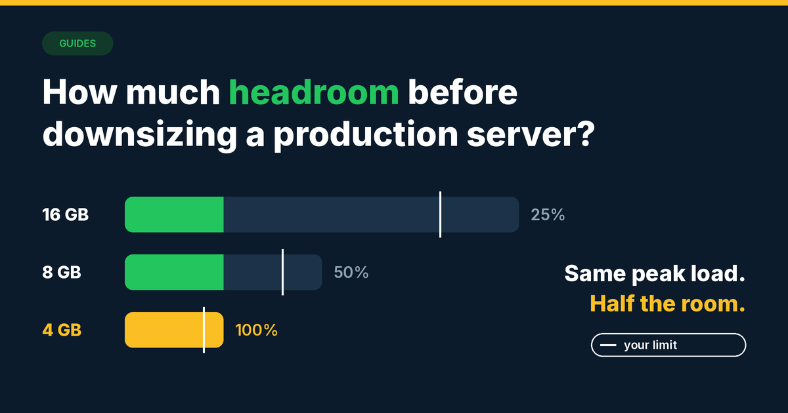

# How Much Headroom Do You Need Before Downsizing a Production Server?

<!-- more -->

Let’s say you cut a database server's memory in half, and it ran fine. CPU use is low,
and the server still shows several GB of memory free. Can you cut it in half again?

It's a fair question, but those numbers don't answer it. A size step usually cuts
capacity in half, and free memory doesn't reliably tell you how much room a
database has to spare.
This article covers what to check instead and how to decide when to stop.

One step down usually means half the capacity. On EC2, instance sizes usually
[double or halve](https://aws.amazon.com/ec2/instance-types/general-purpose)
CPU and memory from one size to the next, though not in every family, so check the
table for your own instance class. If the load stays the same, the workload uses
about twice as much of the smaller machine, and a server that peaks at 40% CPU
will peak at roughly 80%. This is why averages mislead you. Look at the busiest
hour, not the typical one.

Make sure the busiest hour is in your data. Some rightsizing tools only look at the
last week or two, so a month-end spike can be missed. One tool's window is 8 days, so it
[doesn't capture spikes](https://docs.cloud.google.com/compute/docs/instances/apply-machine-type-recommendations-for-instances)
that happen less often than that. Pull the numbers yourself for a period
that includes your busiest time.

Memory is easy to misread. How much memory is free depends on the database's cache
settings as well as its workload, so it's a poor guide to how much you can cut. Having several GB free after a resize doesn't mean you can cut again.

Part of the reason is that the cache is often sized as a share of the instance's
memory. On RDS for PostgreSQL, the default cache size is
[based on the instance's memory](https://docs.aws.amazon.com/AmazonRDS/latest/UserGuide/PostgreSQL.Tuning.concepts.memory.html).
Halve the instance and the cache halves too, so less memory is in use. That doesn't
mean the workload needs less. If you've set the cache to a fixed size instead of the
default, it won't shrink with the instance, so check that it still fits.

So what should you watch? Swap usage, how much data is read from disk, and latency.
On RDS, read freeable memory and swap together: freeable memory
[falling while swap rises](https://www.repost.aws/knowledge-center/troubleshoot-rds-swap-memory)
can show memory pressure, and freeable memory that stays low
[points to needing a larger instance](https://www.repost.aws/knowledge-center/troubleshoot-rds-swap-memory).
That only works in one direction. Low freeable memory can tell you that you've cut
too far, but plenty of freeable memory doesn't prove you can cut more. Swap that has
been used once doesn't go back to zero, so look at whether it's growing, not just
whether it's above zero. If the cache gets too small for your frequently used data,
reads that used to come from memory go to disk, and read I/O and latency can rise.

Some limits shrink with the size too. On RDS and Aurora for PostgreSQL, the default
maximum number of connections is
[derived from the instance's memory](https://docs.aws.amazon.com/AmazonRDS/latest/AuroraUserGuide/AuroraPostgreSQL.Managing.html),
so a smaller instance allows fewer. Check your peak connections against the new
limit before you resize.

Then wait before you judge the result. Changing the instance class
[causes downtime](https://docs.aws.amazon.com/AmazonRDS/latest/UserGuide/USER_ModifyInstance.Settings.html),
and after a restart a database
[can lose cached data and slow queries](https://www.repost.aws/knowledge-center/rds-mysql-slow-query).
It may read from disk more at first and run slower until the cache refills. On RDS for MySQL, you can set parameters that warm the cache faster after
a restart. Look at the result after the cache has warmed up and a busy period has
passed, not in the first few minutes.

Here is a simple way to decide each step:

1. Pick your limit first. Decide the highest peak you're willing to run at after
   the change. There's no universal number. A lower limit suits a service where an
   overload hurts customers and capacity is slow to add. A higher one suits a
   service that can add capacity in minutes. Write it down before you look at the
   data.
2. Get the peaks, not the averages, for a period that includes your busiest time.
   Collect CPU, memory in use, connections, disk reads, and latency.
3. Work out one step. If the load stays the same, peak CPU doubles when you halve
   the size. Compare peak
   connections with the new maximum. Think about whether your frequently used data
   will fit in the smaller cache.
4. If the result stays under your limit with room to spare, take one step, not two.
5. Wait for the cache to warm up and a busy period to pass. Then check swap, disk
   reads, latency, errors, and connections. If they hold, treat these numbers as
   your new starting point and repeat from step 2.

Stop when the next step would put you over your limit, when swap keeps rising or
disk reads and latency stay high after the cache has warmed up, or when the saving
isn't worth the risk.

So can you cut in half again? Having several GB free doesn't answer that. You need
to check swap and disk reads once the cache has warmed up, whether your peak
connections fit under the new limit, and whether doubling your peak CPU again still
stays under your limit.

To judge each step afterward, see
[How to Verify a Cost Change Was Safe](https://docs.consizehq.com/blog/how-to-verify-a-cost-change-was-safe/). If
you're deciding what to change first, see
[Which Cost Recommendation Should You Apply First?](https://docs.consizehq.com/blog/which-cost-recommendation-to-apply-first/)

We're building Consize, an open-source tool that applies cost changes in small steps
and verifies each one. It isn't launched yet, but you can follow the project on
[GitHub](https://github.com/consize-oss/consize).
