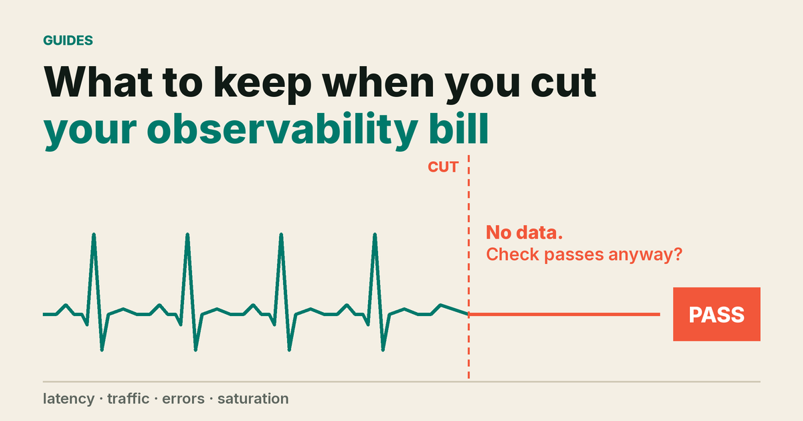

# What to Keep When You Cut Your Observability Bill

A release check that can't find any data has to decide what that means. Depending
on how it's written, it can treat the silence as a pass.

<!-- more -->

That's the risk when you cut your monitoring bill. Some of the numbers you remove
are the ones your release checks read, and a check with nothing to read doesn't
always fail. This article covers which numbers to keep, how sampling affects them,
what checks do when data goes missing, and how to test your setup after a cut.

Start with what you need in order to know that a release broke. Google's SRE book
names four signals for any user-facing service:
[latency, traffic, errors, and saturation](https://sre.google/sre-book/monitoring-distributed-systems/),
which means how full the most constrained resource is. A shorter version, the
[RED method](https://grafana.com/docs/grafana/latest/dashboards/build-dashboards/best-practices/),
covers request rate, errors, and duration. For each service, that's a handful of
numbers: how many requests came in, how many failed, how long they took, and for
services limited by something like memory or a connection pool, how full it is.
Traces and logs help you find out why something broke. These numbers tell you that
it did. Our view is that if you have to cut, cut the detail before you cut the
detection.

Sampling doesn't always change those numbers. It depends on where the sampling
happens and how your tool calculates them. In Datadog, for example, request,
error, and latency numbers are
[calculated from all traffic, whatever your trace sampling settings](https://docs.datadoghq.com/tracing/metrics/).
But if an application samples inside its OpenTelemetry SDK, those numbers come
from the sampled data. If you sample in the OpenTelemetry Collector, the step that
turns spans into counts has to
[run before the sampler](https://docs.datadoghq.com/tracing/metrics/metrics_namespace/),
or it only counts what's left. Other tools work differently, so check how yours
does it before you trust a sampled service.

Turning tracing off for a service is a different cut from sampling it. In the same
example, those numbers are calculated in the agent from traces that the
instrumented application sends, so a service that is no longer traced has no such
numbers.

If you do sample traces, pay attention to which ones you keep. Head sampling,
which decides when a request starts, can't guarantee that every trace containing
an error is kept. Tail sampling, which decides after the trace finishes, can keep
every error and slow trace, but it needs components that store data and are harder
to run, and the best options can be specific to one vendor. Sampling is one of
the most effective ways to cut cost, but done poorly it can miss information you
needed. This is covered in OpenTelemetry's
[sampling guide](https://opentelemetry.io/docs/concepts/sampling/).

Automated release checks read from the same data. Argo Rollouts analysis runs
queries against metric providers such as Prometheus or
[Datadog](https://argoproj.github.io/argo-rollouts/analysis/datadog). Harness
Continuous Verification reads metrics and logs from
[health sources](https://developer.harness.io/continuous-delivery/use-continuous-delivery/verify-deployments/continuous-verification-faqs)
such as Datadog, Prometheus, and New Relic. If you cut the data, the check has less
to look at.

What a check does when data is missing depends on how it's set up. With Argo
Rollouts' Datadog provider, a query over a period with no metrics returns an empty
result, which causes an error during evaluation unless the condition handles it.
The example in Argo's
[Datadog guide](https://argoproj.github.io/argo-rollouts/analysis/datadog) handles
it with `default(result, 0)`, which treats no data as zero, so a check such as
"error rate below 5%" passes when nothing is reported. Conditions for Prometheus
can be written the same way, so that
[no data counts as a pass](https://oneuptime.com/blog/post/2026-08-02-argo-rollouts-prometheus-analysis-results/view).
In Harness, a metric that produces no data isn't analyzed, and an option called
[Fail on no analysis](https://developer.harness.io/3k-docs/continuous-delivery/verify/continuous-verification-faqs)
makes the step fail when there's no data.

No data can mean two different things: nothing went wrong, or nothing is being
reported. Some systems don't report a metric at all when there's no data for it.
Load balancer metrics, for example, are
[not reported when there's no data](https://docs.aws.amazon.com/elasticloadbalancing/latest/application/load-balancer-cloudwatch-metrics.html).
So pair every error check with a request-count check. That lets a check tell "no
errors" apart from "nothing is arriving."

If you stop tracing a service, the same headline numbers may exist somewhere else.
A load balancer can report request counts and response codes. An AWS Application
Load Balancer, for example, publishes
[request counts and error counts](https://docs.aws.amazon.com/elasticloadbalancing/latest/application/load-balancer-cloudwatch-metrics.html)
to CloudWatch. A service mesh such as Istio generates
[request counts and request durations](https://istio.io/latest/docs/reference/config/metrics/),
with response codes, for every request it handles. You would still need to get
them into whatever your release checks read.

After a cut, check your work:

1. List what your release checks and alerts read, service by service.
2. Confirm each of those is still being collected, at the volume the check expects.
3. Decide what a missing value should do. For a release check, we'd choose hold or
   fail, not pass.
4. Deploy a known-bad version to staging, for example one that returns errors or
   responds slowly. See whether your alerts fire and your release check stops it.
5. Make cuts in steps and repeat the test after each one, so you know which cut
   broke what.

If you're deciding whether to restore the signals or buy a separate
release-verification tool, ask these questions of any tool:

- What data does it read, and is that data you've cut?
- What does it do when data is missing: pass, fail, or say it can't tell?
- Can you test it with a known-bad release?
- What does it cost compared with restoring what you removed, and what does it add
  to maintain?

A tool that collects its own data doesn't depend on what you kept, but it's likely
one more thing to run and pay for. We haven't evaluated any specific tool for this
article.

To judge any cost change after you make it, see
[How to Verify a Cost Change Was Safe](https://docs.consizehq.com/blog/how-to-verify-a-cost-change-was-safe/).

We're building Consize, an open-source tool for making cost changes safer. It
applies changes in small steps and verifies each one. It isn't launched yet, but
you can follow the project on [GitHub](https://github.com/consize-oss/consize).
