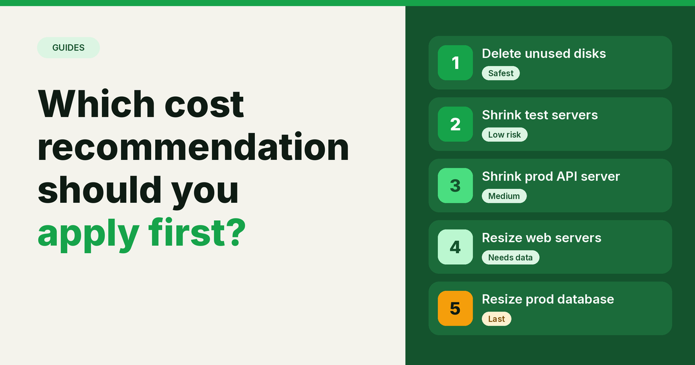

# Which Cost Recommendation Should You Apply First?

<!-- more -->

Opslyft, a cloud cost vendor, says it has seen teams
[turn on AWS Compute Optimizer, get hundreds of recommendations, and sit on them for six months](https://www.opslyft.com/blog/aws-compute-optimization),
because nobody wants to be the person who downsizes the wrong instance. Its
diagnosis is that the data isn't the problem. The gap is between getting a
recommendation and acting on it.

A tool can tell you what a change might save. It can't tell you how bad a
failure would be for your business, or whether you could undo the change. That's
your team's call, and it decides which item you can safely do first.

This article gives you four questions for sorting recommendations, a rough order
to work in, and an example with made-up numbers. It also explains why the first
change shouldn't be the biggest saving. Where the details differ by provider, it
covers AWS, Google Cloud, and Azure.

## What your tool already tells you

Tools differ in how much sorting they do for you. AWS Compute Optimizer
[classifies each recommendation by savings opportunity and performance risk](https://aws.amazon.com/blogs/compute/optimize-ec2-costs-with-aws-compute-optimizer-right-sizing/)
and ranks the options for an instance by estimated savings, performance risk,
and migration effort. A great way to use that is to start with over-provisioned
instances that have high savings and low performance risk, then check with the
people who own the application, because metrics can miss seasonal traffic and
scheduled batch jobs.

Google Cloud's VM rightsizing recommendations show estimated savings and
[can be sorted by them](https://docs.cloud.google.com/compute/docs/instances/apply-machine-type-recommendations-for-instances).
Azure Advisor shows
[estimated savings for a resize or a shutdown](https://learn.microsoft.com/azure/advisor/advisor-cost-recommendations),
and the current and target size for a resize.

None of these tools know how bad a failure would be for you, whether you can
reverse the change, or how thin the data behind it is. The four questions below
cover that.

## Four questions to ask about every recommendation

Answer them in this order. Savings come last.

### 1. If I'm wrong, how bad is it?

Think about who would notice, and for how long. A test server that runs slowly
for an hour annoys a few engineers. A production database that goes offline
affects customers.

How a change is applied differs by provider.

| | Server or VM | Managed database |
|---|---|---|
| **AWS** | With an EBS-backed disk, you [stop the instance, change its type, and start it again](https://docs.aws.amazon.com/AWSEC2/latest/UserGuide/ec2-instance-resize.html). A server with an instance-store root disk has to be migrated to a new instance. | On RDS, changing the instance class [involves downtime](https://docs.aws.amazon.com/AmazonRDS/latest/UserGuide/USER_ModifyInstance.Settings.html). Multi-AZ can reduce it, and you choose whether to apply right away or in the next maintenance window. |
| **Google Cloud** | You can [only change the machine type of a stopped VM](https://docs.cloud.google.com/compute/docs/instances/changing-machine-type-of-stopped-instance). Applying a recommendation in the console stops the VM, changes the type, and restarts it. An ephemeral external IP address might change. | On Cloud SQL, changing the machine type [triggers a restart, which means downtime](https://docs.cloud.google.com/sql/docs/mysql/recommender-underprovisioned). |
| **Azure** | A running VM [restarts when you change its size](https://learn.microsoft.com/en-us/azure/virtual-machines/sizes/resize-vm). Deallocating it releases dynamic IP addresses. The disks aren't affected. | On Azure SQL Database, [connections move to a new compute instance](https://learn.microsoft.com/en-us/azure/sql-database/sql-database-scale-up), so existing connections drop and your app needs retry logic. On PostgreSQL flexible server, [changing vCores or the compute tier restarts the server](https://learn.microsoft.com/en-us/azure/postgresql/scale/concepts-scaling-resources). Near-zero-downtime scaling typically takes 10 to 30 seconds where it's supported. |

On AWS, data on local instance-store disks doesn't survive a stop.

The more people who would notice, and the longer it would last, the later the
change goes on your list.

### 2. Can I undo it?

Some changes are usually reversible: you change the size back, though that can
mean another restart or more downtime. Others can't be undone. Deleting a disk is
the common example.

On AWS, an unattached volume keeps billing until you delete it, and
[deleting it can't be undone](https://www.repost.aws/questions/QUXQroPIeIQO-fz0L5AAuFCA/ebs-volume-being-billed-but-not-found).
[Snapshots cost less than active volumes](https://www.repost.aws/knowledge-center/ebs-charge-stopped-instance),
so [back up anything important first](https://docs.aws.amazon.com/prescriptive-guidance/latest/optimize-costs-microsoft-workloads/ebs-delete-ebs-volumes.html).
Google Cloud's recommender
[treats a Persistent Disk as idle](https://docs.cloud.google.com/compute/docs/viewing-and-applying-idle-resources-recommendations)
once it has been detached for 15 days, and for a disk with data it suggests a
snapshot before deleting. On Azure,
[deleting a VM leaves its disks in place and still billing](https://learn.microsoft.com/en-us/azure/virtual-machines/disks-find-unattached-portal),
and deleting a disk is permanent.

On every provider, back up anything that might matter before you delete it. That
turns a one-way change into one you can reverse. A change you can reverse in
minutes goes ahead of one you can't.

### 3. How much do I trust the data behind it?

A recommendation only reflects the history it was built from, and each tool looks
at a different window.

| | Default window | Watch out for |
|---|---|---|
| **AWS Compute Optimizer** | [14 days, with 32 or 93 days as options](https://docs.aws.amazon.com/compute-optimizer/latest/ug/rightsizing-preferences.html). It needs [at least 30 hours of metrics](https://docs.aws.amazon.com/compute-optimizer/latest/ug/requirements) for an EC2 instance. | Memory only counts if you turn on memory metrics, with the CloudWatch agent or a [supported monitoring tool](https://aws.amazon.com/blogs/compute/optimize-ec2-costs-with-aws-compute-optimizer-right-sizing/). |
| **Google Cloud VM rightsizing** | [The last 8 days](https://docs.cloud.google.com/compute/docs/instances/apply-machine-type-recommendations-for-instances) | Monthly spikes are a poor fit, because 8 days isn't enough to capture them. CPU is averaged over 60-second intervals, so brief spikes are missed. The Ops Agent gives better memory data. |
| **Azure Advisor** | [7 days, configurable](https://learn.microsoft.com/azure/advisor/advisor-cost-recommendations) up to 90 | Resize recommendations use CPU, memory, and outbound network. Shutdown recommendations use CPU and network only. |

Each tool also has its own idea of spare room. For user-facing workloads, Azure
Advisor aims to keep P95 CPU and outbound network at 40% or less and P99 memory at
60% or less on the recommended size, so check what yours assumes.

Size can also change limits you don't see, such as the number of database
connections. The providers differ here, so don't assume the rule from one cloud
applies on another.

- AWS RDS (MySQL and PostgreSQL): the default maximum number of connections is
  [based on the instance's memory](https://aws.amazon.com/premiumsupport/knowledge-center/rds-mysql-max-connections/),
  so a smaller instance class allows fewer connections.
- Azure Database for PostgreSQL flexible server: the default is
  [calculated when you create the server](https://learn.microsoft.com/en-us/azure/postgresql/flexible-server/server-parameters-table-connections-and-authentication-connection-settings),
  and changing the compute later doesn't change it. More connections use more
  memory, so [instances with limited memory can see crashes or high latency](https://learn.microsoft.com/en-us/azure/postgresql/configure-maintain/concepts-limits#maximum-connections).
  After a downsize, check your connection count against the new memory, not only
  against the limit.

If your connection peak on RDS is already above 80% of the limit, one
[RDS guide](https://cloudchipr.com/blog/aws-rds-right-sizing) suggests putting a
pooler such as RDS Proxy in place before downsizing.

So ask: How many days of data is this based on? Did it include my busiest
period? Did it look at memory, and at limits that change with size? If the data is
thin, move the item down the list until you have more.

### 4. How much does it save?

Savings go last. They tell you what a change is worth, but not whether it's safe
to try. Treat the dollar figure as an estimate, and check how your tool
calculates it.

- AWS estimates based on On-Demand prices
  [can be well above what you'd save once your existing discounts count](https://aws.amazon.com/blogs/compute/optimize-ec2-costs-with-aws-compute-optimizer-right-sizing/).
  Enabling Cost Optimization Hub switches Compute Optimizer to after-discount
  pricing.
- Google Cloud bases its estimate on
  [the previous week's usage, extrapolated to 30 days, before sustained use discounts](https://docs.cloud.google.com/compute/docs/instances/apply-machine-type-recommendations-for-instances).
  It also hides recommendations that would save less than $10 a month.
- Azure shows estimated savings for both resize and shutdown. We didn't check how
  it handles discounts.

Use savings to break ties between changes that are equally safe.

## A rough order to work in

| Order | What it is | Why it goes here | Before you start |
|---|---|---|---|
| 1 | Things nobody uses, such as unattached disks and idle test resources | If they're truly unused, nothing depends on them | Find the owner, check it wasn't detached on purpose, and snapshot or back up first |
| 2 | Shrinking test and development systems | Mistakes cost less, and you get to practice your process | Treat it like production: write down what you'll watch |
| 3 | Shrinking production systems that can restart without losing data and run as more than one copy | If one copy has trouble, the others can carry the load | Watch errors and speed at your busiest time |
| 4 | Production databases and anything else that holds data | Changes can involve downtime, and some limits depend on size | Use a maintenance window, check your peak connections, snapshot first, have a rollback plan |
| 5 | Changes that remove spare capacity, such as fewer servers or no standby copy in production | You're cutting your margin for failure, not just the size of one thing | Check that you could still lose one server and stay up |

This order is a rule of thumb, not a standard, and your own systems may rank
differently. A database with a tested restore and a standby may be less risky
than a poorly understood server.

Two other sources, both focused on AWS, rank things in a similar way. An SRE's
[guide to safe downsizing](https://dev.to/june-gu/downsizing-without-downtime-an-sres-guide-to-safe-cost-optimization-1lck)
rates orphan cleanup as very low risk, EC2 and RDS right-sizing as medium, and
puts Reserved Instances last. It also lists production Multi-AZ among the things
not to touch. Opslyft's
[tiers](https://www.opslyft.com/blog/aws-compute-optimization) put idle
resources and dev or staging systems at the safe end, production EC2 in the
middle, and database instance changes at the top of the risk scale, which it says
should never be applied automatically. Both are single views, not standards.

One more thing: if you plan to buy long-term commitments, shrink first. Two AWS
guides, the [RDS guide](https://cloudchipr.com/blog/aws-rds-right-sizing) and the
SRE guide, make this point about Reserved Instances. A commitment bought for an
oversized resource locks in the waste, and one bought before you downsize may no
longer match what you run. A Google Cloud guide makes a similar point about
[committed use discounts](https://www.nops.io/blog/gcp-right-sizing/). Check how
your provider's commitments interact with a resize before you buy.

## An example, with made-up numbers

Say your tool gives you these five recommendations. The savings are invented for
the example.

| Recommendation | Est. saving per month | If wrong | Undo | Data behind it | Order |
|---|---|---|---|---|---|
| Shrink the production database | $900 | Customers affected | Changing back means more downtime | 14 days | 5th |
| Shrink the web servers (4 CPUs to 2 each) | $400 | Medium | Usually reversible, may need restarts | Only 3 days | 4th, until there's more data |
| Shrink a production API server | $250 | Medium | Usually reversible, may need a restart | 30 days, memory included | 3rd |
| Shrink a test server | $120 | Low | Usually reversible | Good | 2nd |
| Delete 12 unattached disks | $60 | Low, once snapshotted | Reversible from the snapshot | Clear | 1st |

Sorted by savings, you'd start with the database. Sorted by the four questions,
the order flips and the database goes last. The web servers rank below the API
server only because they have 3 days of data. With 30 days, they'd sit next to it.
Everything still gets done. The order only decides what goes first.

## Why the biggest saving shouldn't go first

Your first change tests more than one server. It also tests how you watch a
change, how you roll it back, and how much your team trusts the process.

The SRE guide's author reports seeing teams follow Cost Explorer
recommendations, downsize an RDS instance during peak hours, and cause a
45-minute outage.

Start small. A safe first win makes the
second change easier to approve, and a bad first change makes everyone more
cautious.

## What to do with this

1. Copy your list of recommendations into a spreadsheet.
2. For each one, answer the four questions in a sentence.
3. Sort by questions 1 to 3. Use savings only to break ties.
4. Start with the top item. Before you apply it, write down what "it worked"
   means: which numbers, compared to what, and for how long.
5. After each change, re-sort the list. You'll know more than you did before.

For step 4, see
[How to Verify a Cost Change Was Safe](https://docs.consizehq.com/blog/how-to-verify-a-cost-change-was-safe/).

We're building Consize, an open-source tool for making cost changes safer. It
isn't launched yet, but you can follow the project on
[GitHub](https://github.com/consize-oss/consize).
