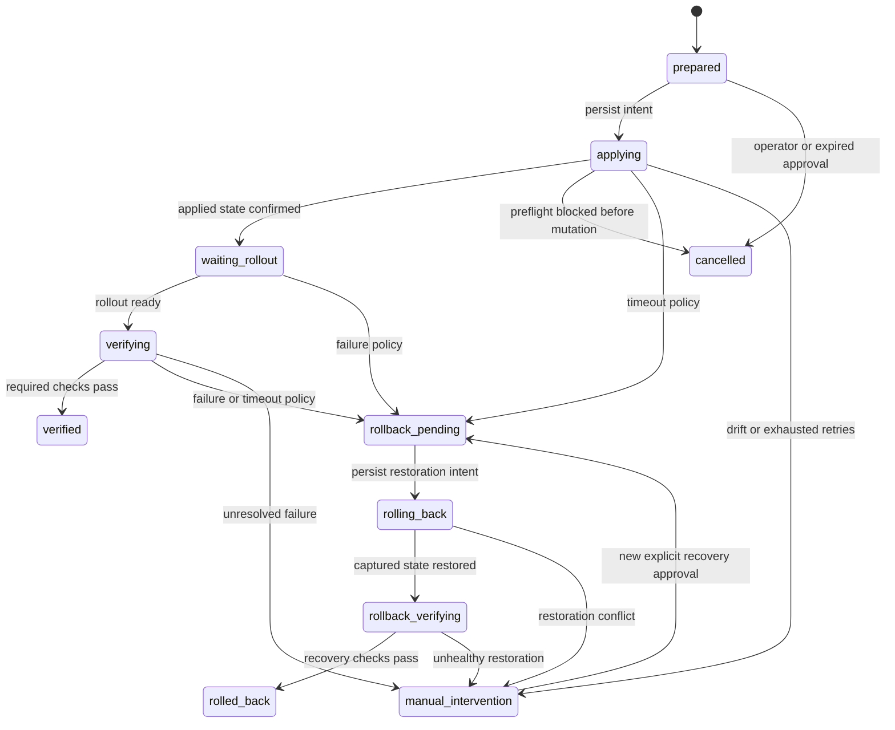

# Durable action workers

The API persists an approved job before returning HTTP 202. Workers claim one bounded phase at a time. The existing action state machine still owns apply, rollout, verification and rollback; leasing does not introduce a second workflow.

## Running

Use the same configuration and `CONSIZE_DATABASE_URL` secret for API and worker processes:

```sh
go run ./cmd/consize serve -config /absolute/path/config.json -addr 127.0.0.1:8080
go run ./cmd/consize worker -config /absolute/path/config.json
```

`serve` runs a worker too. PostgreSQL claims coordinate all of these processes. For the JSON `state_path` lab, run only one process: its lifetime file lock rejects a second process using that file.

Example worker settings, placed inside the existing configuration object:

```json
{
  "worker": {
    "poll_interval": "5s",
    "lease_duration": "1m",
    "heartbeat_interval": "5s",
    "step_timeout": "20s",
    "max_attempts": 8,
    "max_jobs_per_tick": 32
  }
}
```

These are the defaults. Polling must be 100ms–1m, leases 3s–5m, heartbeat at most one-third of the lease, and each phase timeout at most half the lease. Attempts must be 1–32 and batch size 1–128. Invalid settings fail startup. Each worker invokes providers serially; round-robin batches prevent early jobs from starving later ones. Adding workers increases concurrency across different jobs.

## Claim and dispatch protocol

1. Read due jobs. Lock the selected PostgreSQL row, then compare its state and revision.
2. Reject a live lease. Otherwise increment its fencing token, start a durable attempt, and commit the claim with its audit event. PostgreSQL's clock determines lease validity.
3. Inspect live provider state before deciding what to do. An expired lease is not evidence that a mutation failed.
4. Persist apply or rollback intent before its external call. Immediately before forward mutation, check the captured plan digest, recommendation expiry, fresh baseline, current foundation-policy decision, plugin release and live provider preflight. Renew ownership again before mutation.
5. Pass the stable dispatch ID, plan digest and attempt token to supporting providers in the execution envelope. Executable plugins advertise support during handshake; older protocol-v1 executables retain their original request shape and idempotent captured-plan contract. Renew the lease during a slow phase; cancel its context if renewal fails.
6. Save the phase result only if its fencing token and revision still match. Finish the attempt and release the claim. An interrupted process leaves a lease that another worker can take over after expiry.

Heartbeats do not increment the workflow revision. A legitimate state save preserves the latest heartbeat instead of overwriting it with the worker's older copy. Captured mutation intent cannot change during a state transition.

Lease ownership fences database writes. It cannot stop arbitrary external code that ignores cancellation from making a late write. Supported action providers must honor deadlines, inspect uncertain outcomes and use idempotent or optimistic-concurrency-safe mutations. The Kubernetes provider compares captured UID/spec/resources and refuses to overwrite external drift. This is durable intent plus reconciliation, not a claim of universal exactly-once network delivery or an operating-system sandbox.

## State flow



Claims and retries are attempt records attached to these states, not extra logical actions. Other nonterminal phases can also require manual attention after a fixed deadline, invalid configuration or unrecoverable failure.

## Retries and recovery

Provider unavailability, missing capabilities, timeouts and uncertain acknowledgements have sanitized failure codes. Retries use exponential backoff from 5 seconds, capped at 160 seconds plus deterministic jitter of less than 25%. The configured attempt cap and existing fixed action/verification deadlines both apply. Transitions reset the per-phase retry counter; attempt history remains.

An uncertain apply or rollback response is inspected on the next attempt before any mutation is retried. Confirmed applied/restored state is not dispatched again. Failed live preflight cancels an unmodified forward action; drift, changed plugin release, retry exhaustion and unrecoverable deadlines require operator attention. Policy configuration and reviewed-plan authorization beyond the foundation policy remain owned by CON-28/30.

For an unresolved job, inspect the resource and its audit history first. Restore the expected plugin release and resolve external drift. The existing `POST /api/recommendations/{id}/recover` command requires explicit approval and rechecks recovery safety; it is not an unconditional replay.

## Cancellation and shutdown

`POST /api/recommendations/{id}/cancel` atomically cancels only a prepared, unclaimed job. Repeating an already successful cancellation returns the same job. If claim wins the race, cancellation returns HTTP 409. After dispatch intent, the API never claims a provider mutation was cancelled; use governed recovery when required.

Shutdown cancels the provider context and makes a bounded attempt to finish/release the claim. If storage is unreachable or the process is killed, lease expiry enables recovery. A worker that lost ownership cannot save, renew or release its successor's work.

## Inspection

`GET /api/jobs` returns jobs plus `worker` queue diagnostics: queued work, active/expired leases, unresolved manual attention, completed jobs, total phase attempts and the oldest due time. Completion includes verified, rolled-back and cancelled outcomes; it is not a savings metric. A queue snapshot does not prove that an idle remote worker process is alive. Use the lease timestamps and process supervision together.

Each job includes its dispatch identity, digest, revision, current lease, sanitized failure code and phase-attempt history. Attempts record worker identity, fencing token, phase, start, finish and outcome. Full state transitions remain correlated through the existing action and audit APIs. Detailed claim events are part of audit history; a product activity summary should not count them as separate actions.

## Upgrade safely

1. Stop all old API and worker processes. Do not roll old and new dispatchers together.
2. Back up the PostgreSQL database or JSON state file using the existing storage procedure.
3. Start the new binary. PostgreSQL migration 005 protects worker-version metadata; JSON schema 7 adds the worker protocol migration. Existing queued jobs retain their identity and state.
4. Legacy queued forward jobs without a captured plan digest fail closed before mutation. Reevaluate and explicitly approve a new recommendation. Already applied or rollback work is inspected and reconciled from its stored snapshots.
5. Confirm `/api/jobs`, storage diagnostics and audit health before starting additional workers.

Older binaries refuse the newer schema at startup. The database also rejects updates that strip an existing worker revision. These checks do not replace stopping already-running old binaries before upgrade. Restore a compatible backup for a downgrade; do not edit migration ledgers or remove lease fields by hand.

## Validation

Run the repository backend gate with the pinned Go version:

```sh
scripts/ci/backend.sh
```

Set `CI=true` for the store suite to create and clean up an isolated pinned PostgreSQL container, or supply `CONSIZE_TEST_DATABASE_URL` for a disposable test database. The suite creates per-test schemas; never point it at an application database.

```sh
CI=true go test -race ./internal/store ./internal/safety ./internal/api -count=1
CI=true go test ./internal/store -run PostgresWorker -v -count=1
```

Tests cover competing connections and subprocesses, lease expiry and stale writes, heartbeat loss, cancellation races, interrupted phases, lost apply/rollback acknowledgements, immutable intent, audit transaction failure, schema upgrades, API contracts and bounded contention soak. Live provider qualification remains separate from deterministic store/controller tests and must be recorded against the exact release commit.
