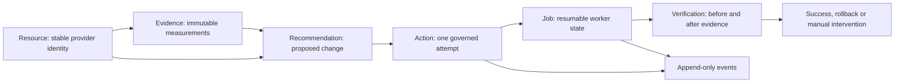

# Core model contracts (v0.3 alpha)

Start here when changing the backend, API, UI, or a plugin. This page describes
implemented contracts on `main`; it does not describe every capability planned
for Consize. Kubernetes Deployments with configured Prometheus evidence are the
current working optimization path. Other resource types can be represented
without being discoverable or actionable.

## Follow one change

Discovery updates a resource, not its old recommendations. Evidence records
explain the measurements behind a proposal. A recommendation records the
proposal; it does not grant permission to execute. An action captures one request,
its policy decision and results. A worker job resumes the approved workflow.
Verification compares recorded observations. Events preserve what happened.

Example: `payments/checkout-api` is observed in `example-cluster`. A collector
records memory usage. An algorithm proposes a smaller memory request. A dry-run
action records a plan. A later approved attempt must still pass authorization,
policy, preflight, baseline and rollback checks. Successful health verification
is not proof of reduced billing.

The following rules are normative for this alpha. Files under
[examples/core-model](examples/core-model/kubernetes-resource-input.json) are
synthetic illustrations, not live measurements or executable change plans.

## Resource: what exists

[`resource.Resource`](https://github.com/consize-oss/consize/blob/main/pkg/resource/resource.go) represents one provider
object. [`resource.Registry`](https://github.com/consize-oss/consize/blob/main/pkg/resource/registry.go) owns its writes,
lookups, lifecycle and reconciliation.

For a new resource, supply:

- Identity: `provider`, `account`, `region`, `type`, `provider_resource_id`.
- Classification: `name`, `environment`, `owner`, `criticality`.

`environment` is `production`, `staging` or `development`; `criticality` is `low`,
`medium` or `high`. The current registry requires a nonempty owner. An unowned
resource in the UI's design fixtures does not mean the backend accepts it.

The store normalizes a create/upsert input before validation:

- `schema_version` defaults to 1; an omitted `id` is derived from identity.
- `lifecycle_state` defaults to `active`; `support_status` is derived by core.
- `labels`, `metadata` and `current_state` default to empty objects.
- `observed_at` defaults to the registry clock. Initial `first_seen_at`,
  `last_seen_at` and `created_at` are populated; `updated_at` is store-owned.
- `source_plugin_id` can be empty for explicitly registered resources; discovery
  supplies it. `lifecycle_observed_at` is a separate presence/lifecycle clock.
- `monthly_cost` is optional descriptive data; zero does not prove a free resource.

Identity is the normalized five-coordinate tuple. New canonical IDs encode it as
`resource:v1:<provider>:<account>:<region>:<type>:<provider_resource_id>` with
URL-escaped components. Never build IDs by joining display names.

Identity cannot change under an existing ID. Name, environment, owner, criticality,
labels, metadata, current state and cost may change. Store updates preserve
creation/first-seen times. An existing source cannot silently be replaced by a
different source. Provider-specific fields belong in the extension objects;
credentials do not. `fully_supported` describes the type's implemented support,
not plugin health, telemetry availability or permission to automate.

See [resource fields and support](resource-model.md),
[registry operations](resource-registry.md),
[identity ADR](../engineering/adr-0001-universal-resource-identity.md), and
[resource tests](https://github.com/consize-oss/consize/blob/main/pkg/resource/resource_test.go).

## Evidence: why a measurement is trustworthy

[`evidence.Record`](https://github.com/consize-oss/consize/blob/main/pkg/evidence/evidence.go) is immutable after sealing.
A producer supplies `resource_id`, `plugin_id`, `signal`, `query`, `kind`,
`aggregation`, `unit`, `original_unit`, `scale`, `value`, `sample_count`,
`window_start`, `window_end`, `collected_at`, `fresh_until` and `quality`.
`Seal` supplies `schema_version` and the content-addressed `id`.

`parents` is required for `derived` evidence and otherwise optional. `extensions`
is optional bounded string metadata. Raw, aggregated and derived records use the
same provenance rules; a percentile summary is not a raw sample stream.

- `valid`, `partial` and `stale` require a number and at least one sample.
- `missing`, `invalid` and `unavailable` require `value: null`. Measured zero is a
  number, not missing data.
- `window_start < window_end <= collected_at <= fresh_until`.
- A valid digest proves content consistency, not authenticity. Freshness and
  consumer-required units/quality are checked separately. `Usable` never rewrites
  historical quality just because time passed.

New evidence produces a new ID. Embedded recommendation snapshots and their
ordered `evidence_refs` must agree exactly, belong to the same resource and
survive restart. Reference-only legacy records remain readable; they do not
establish usable provenance for a new built-in decision.

See [quality, normalization and retention](evidence.md),
[evidence tests](https://github.com/consize-oss/consize/blob/main/pkg/evidence/evidence_test.go), and
[snapshot persistence tests](https://github.com/consize-oss/consize/blob/main/internal/store/evidence_test.go).

## Recommendation: what is proposed

[`store.Recommendation`](https://github.com/consize-oss/consize/blob/main/internal/store/store.go) freezes a proposal for
one resource. The store requires an existing `resource_id`, nonempty `plugin_id`,
`action_type`, `algorithm_id` and `evidence_refs`. Here `plugin_id` names the
proposed **action** plugin; evidence records name their own measurement plugins.

For typed evidence, also supply `algorithm_version` and `evidence_snapshot` with
one validated record per ordered reference. Keep `title`, `summary`, `current`,
`proposed`, `parameters`, human-readable `evidence`, `confidence`, `risk` and
`policy_id` with the proposal so reviewers can understand it. The store's minimum
write validation does not guarantee that every possible imported proposal is
safe, actionable, or sufficiently explained.

The store assigns `id`, `schema_version`, `created_at` and `updated_at`. Creation
starts at `pending`. `recommendation_type` defaults to `action_type` and an omitted
algorithm version defaults to `1` only for legacy/reference-only inputs. Empty
proposal objects become `{}`. `estimated_savings_monthly` and `savings_estimate`
retain the estimate; `cost_estimate` is optional pricing provenance. Savings
classification must not be confused with the action's health result.
`savings_estimate` contains `classification`, `amount_monthly`, and optional
`currency`, `source` and `calculated_at`.

`expires_at` is optional and must be in the future when supplied at creation.
`status_reason` and `superseded_by` record lifecycle decisions. An expiry timestamp
alone is not the same thing as a recorded `expired` transition. New actions reject
expired timestamps even before a lifecycle transition has been written.

Proposal content is immutable after creation. Lifecycle methods may change
`status`, `status_reason`, `superseded_by` and `updated_at`; the worker can also
record its captured policy ID. New evidence creates a new recommendation.
Supersession must reference a replacement for the same resource.

## Action: one attempt to realize a proposal

[`store.Action`](https://github.com/consize-oss/consize/blob/main/internal/store/contracts.go) requires an existing
`recommendation_id`, matching `resource_id`, `plugin_id` and `action_type`, plus
`remediation_path`, `mode`, `idempotency_key` and `requested_by`. Supported store
modes are `dry_run` and `approved`. A nonempty path string is not proof that an
execution implementation exists for that path.

`plugin_version`, `correlation_id`, `approved_by` and `parameters` capture request
context when supplied. The store generates correlation when absent and defaults
parameters to `{}`. It assigns `id`, `schema_version`, `status: requested`,
`requested_at` and `updated_at`.

The request identity, plugin/version, path, mode, idempotency key, correlation,
requester, parameters and captured `policy_decision` cannot change through a
transition. Governed transitions update status, approver and lifecycle timestamps,
`plan_result`, `execution_result`, `failure_code` and `failure_message`.
`approved_at`, `started_at` and `finished_at` record the corresponding lifecycle
milestones. Optional timestamps may serialize as a zero date in existing Go JSON;
check the status and actual timestamp rather than treating field presence as proof.

The globally unique idempotency key reuses an existing matching request. A changed
recommendation/resource/plugin/action type/mode with that key is rejected; callers
must not reuse a key to ask for a different proposal. Idempotency grants no approval.
A dry-run plan is not an execution result.

See [exact lifecycles and savings terms](../engineering/recommendation-action-contracts.md),
[contract tests](https://github.com/consize-oss/consize/blob/main/internal/store/contracts_test.go) and
[the separation ADR](../engineering/adr-0002-proposals-attempts-and-evidence.md).

## Jobs, verification and history

A [`store.Job`](https://github.com/consize-oss/consize/blob/main/internal/store/jobs.go) is worker recovery state, not a
second recommendation. It keeps `id`, `action_id`, `recommendation_id`, the
captured `resource`, `plan`, `baseline`, `verification` configuration, `policy` and
`actor`. Creation checks the recommendation/action/plan relationship and reserves
the resource against another unresolved job.

The worker updates `state`, `attempts`, `next_run`, `window_start`, `deadline`,
`last_error`, `updated_at`, `verification_result` and `plugin_result`. Job states
such as `prepared`, `applying`, `waiting_rollout` and `rollback_verifying` are not
interchangeable with public action states. `manual_intervention` stops ordinary
processing but continues to reserve the resource.

[`verification.Result`](https://github.com/consize-oss/consize/blob/main/internal/verification/verification.go) contains
`status`, `reasons`, `before`, `after`, `checked_at` and `thresholds`. Status is
`passed`, `failed` or `inconclusive`. Missing or mismatched evidence cannot become a
successful verification. These results remain in jobs and historical action events.

[`store.ActionEvent`](https://github.com/consize-oss/consize/blob/main/internal/store/store.go) is the compatibility action
history: generated `id`/`created_at`, resource/plugin/action identity, optional
`action_id` and `recommendation_id`, actor/mode/result/message, parameters, captured
policy decision, and optional plan/plugin/verification results. It is append-only.
`GET /api/actions` returns this history; `GET /api/action-records` returns attempts.

The broader audit subsystem records discovery, evidence and other events as well.
Use its [event contract and query API](../engineering/audit-subsystem.md) rather than
assuming the action-event feed contains every audit record. See
[worker recovery tests](https://github.com/consize-oss/consize/blob/main/internal/safety/controller_test.go).

## Registry and persistence boundaries

The registry is a durable inventory, not a provider deletion API. Stale means
presence is uncertain; deleted is a retained tombstone. A complete successful scan
may mark absent objects stale within its exact provider/account/region/type/source
scope. Confirmed deletion must be explicit. Failed or partial scans cannot safely
reconcile absence. The current discovery runner upserts only; scheduled complete
scan reconciliation is not yet wired into it.

Reads detach mutable values. Listing uses live ID-ordered keyset pages, not a frozen
snapshot across requests. Legacy IDs are preserved during canonical rediscovery.
No automatic tombstone or evidence retention policy removes historical references.

Memory is ephemeral. The JSON-file store is for one local process; PostgreSQL is
the shared durable backend. A failed write must return an error, never successful
state. Review [persistence guarantees and migrations](../engineering/durable-storage.md)
and [registry concurrency details](resource-registry.md) before changing a write path.

Entity `schema_version`, JSON-file state version and PostgreSQL migration number
are separate versions. Never infer one from another. Existing migration files are
immutable; add the next migration. Unsupported newer durable versions, changed
migration checksums and invalid references fail startup. Old events must not be
reinterpreted as approvals or successful actions. Public field changes must update
[OpenAPI](https://github.com/consize-oss/consize/blob/main/openapi/openapi.yaml) and generated declarations together and pass
compatibility CI.

## Examples and review

Read these in order. All are synthetic and validated by
[the model documentation tests](https://github.com/consize-oss/consize/blob/main/internal/modeldocs/docs_test.go):

1. [Kubernetes registration input](examples/core-model/kubernetes-resource-input.json).
2. [Normalized resource](examples/core-model/kubernetes-resource.json).
3. [Sealed evidence](examples/core-model/evidence.json).
4. [Recommendation store input](examples/core-model/recommendation-input.json).
5. [Dry-run action store input](examples/core-model/action-input.json).

The query in the evidence example illustrates provenance shape, not a recommended
production PromQL configuration. The action input illustrates the store contract,
not an HTTP command or a complete executable plan. Its recommendation ID `1`
assumes the first proposal in an empty example store; real callers use the
returned recommendation ID. Historical sample timestamps
are fixed: the examples do not constitute fresh evidence today.

[The RDS input](examples/core-model/future-rds-resource-input.json) demonstrates
**model compatibility only**. Normalization yields `model_only`. It does not
install RDS discovery, metrics, a recommender or an action implementation.

Before approving a model change:

- Check identity, immutability, time boundaries and reference ownership against
  the linked validators and tests.
- Check lifecycle names against store transitions; separate resource, action,
  recommendation, job and verification states in API/UI copy.
- Validate the examples and local links with `go test ./internal/modeldocs`.
- Confirm model-only examples are not described as runnable integrations.
- Have a maintainer review any new lifecycle or compatibility claim. That review
  remains a PR approval requirement, not something a documentation test can grant.
