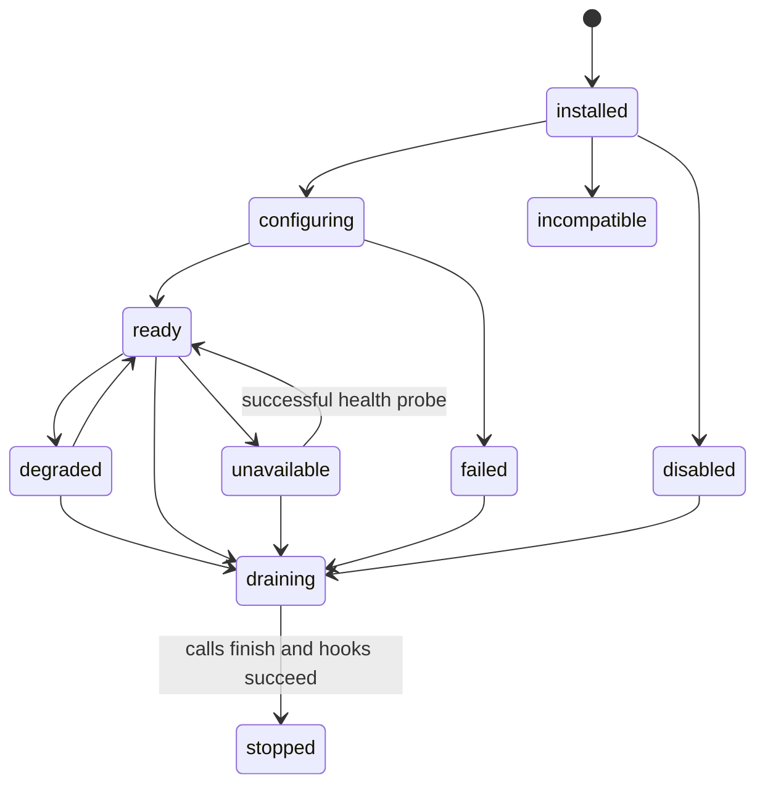

# Plugin runtime

The SDK manager in `pkg/plugin` owns configured plugin instances. Core workflows
receive its typed handles, not raw Kubernetes or Prometheus implementations.
Provider construction lives in `internal/bootstrap`. The built-in recommender
registers through an SDK adapter in `internal/recommender`.

## Package and instance identity

A package has one manifest: ID, display name, semantic version, category, resource
and action types, mutation/approval declarations, and a `runtime` declaration.
The latter contains SDK/core compatibility ranges, provider, configuration schema
version, distribution, optional integrity expectation, and versioned capabilities.

An instance has its own ID, package ID, required/disabled flags, provider/account/
location scope, timeout and configuration. Two clusters use different instance
IDs even when their package and version match. Different instances must not
share the same mutable Go provider object. One instance can intentionally expose
several capabilities, such as Kubernetes discovery and actions.

SDK and core versions are `RuntimeSDKVersion` and `RuntimeCoreVersion`. Ranges
are intersections of explicit semantic-version comparisons, for example
`>=1.0.0 <2.0.0`. Exact versions and `=`, `>`, `>=`, `<`, `<=` work. Carets,
wildcards, OR expressions and implicit versions are rejected. Capability major
version 1 is implemented. An incompatible optional instance remains visible but
cannot execute; a required incompatible instance prevents startup.

Supported executable capabilities are `resource.discover`, `metrics.read`,
`cost.read`, `action.plan`, `action.execute`, `action.preflight` and
`recommendation.generate`. `notification.send` is a reserved descriptor, not a
notification implementation. A package declaring an executable capability must
implement its SDK interface. Metadata alone never creates an executable adapter.

## Configure instances

Existing top-level `kubernetes`, `prometheus` and `pricing` configurations still
work. They become required instances with their historical package IDs. Their
configuration is validated before activation, and required dependencies must
pass initial readiness checks. A provider reporting degraded health must explicitly declare `ready: true` to satisfy a required startup binding; Kubernetes does so after verifying scoped list access, while still awaiting its first complete scan. A previously tolerated unreachable enabled provider
now fails startup instead of appearing ready.

Use `plugin_instances` for separately scoped instances:

```json
{
  "state_path": "./state.json",
  "plugin_instances": [
    {
      "id": "production-discovery",
      "package_id": "kubernetes-action",
      "required": true,
      "provider": "kubernetes",
      "account": "production",
      "location": "eu-west",
      "timeout": "60s",
      "configuration": {
        "kubeconfig": "/run/secrets/production-kubeconfig",
        "context": "production",
        "cluster_id": "production",
        "location": "eu-west",
        "discovery": {"namespaces": ["payments"]}
      }
    },
    {
      "id": "production-metrics",
      "package_id": "prometheus-metrics",
      "required": true,
      "provider": "kubernetes",
      "account": "production",
      "location": "eu-west",
      "configuration": {
        "base_url": "https://prometheus.internal",
        "window": "24h",
        "step": "5m",
        "transport": {"auth": {"bearer_token_env": "PROMETHEUS_TOKEN"}}
      }
    }
  ]
}
```

Set workflow bindings such as `recommender.metrics_plugin_id`,
`recommender.action_plugin_id`, `collection.plugin_id` and
`verification.metrics_plugin_id` to **instance IDs**. The built-in algorithm
remains the default; `recommender.algorithm_plugin_id` can select another registered
recommender. Do not configure the same instance in both the legacy and new forms.
New explicit instances require all three routing coordinates. Kubernetes also
checks that these coordinates match its configured client scope. The legacy
Prometheus/rate-card instances remain shared within their declared provider;
Prometheus still binds each query to the requested resource's cluster and UID.

Package-specific configuration uses the existing provider fields. Unknown fields
are rejected. An unavailable optional metrics provider leaves disabled/manual collection unavailable without preventing API startup. Enabled collection scheduling still requires its configured provider. A failed optional configuration or initializer is retained as a
failed instance and does not activate capabilities. Duplicate identities and
malformed manifests/configuration envelopes are configuration errors, including
for optional instances. Disabled factory instances do not construct the provider.

Keep credentials in existing provider environment/file references. Never put
credential values in ordinary configuration. For an SDK initializer requiring
named secrets, map `secret_refs` from parameter name to reference name, and
`plugin_secret_env` from reference name to environment variable name. The host
resolves values separately and supplies them only to `Initialize`; references
must be simple names. Missing required references prevent activation. Built-in
providers use their existing credential-reference fields and do not implement
this additional initializer contract. Secrets and raw configuration never enter
runtime status or lifecycle audit events. A configuration fingerprint is stored.

## Lifecycle and health



`discovered` is reserved for package enumeration. Package factories represent
installed packages; status records describe configured instances. Initialization
runs configuration validation, optional initialization, scope validation and
required health checks before binding capabilities. Optional `Drain` and
`Shutdown` hooks run after active calls finish. Hooks must be idempotent.

Timeouts default to 30 seconds and cannot exceed five minutes. Static manifest
callbacks have a five-second timeout and a separate limit of 16 active callbacks.
Each instance allows at most 16 concurrent callbacks. A provider that ignores
cancellation keeps its slot until it exits. Drain waits use the instance timeout; whole-manager shutdown has a five-minute ceiling (the CLI uses ten seconds). A timed-out drain stays draining and
rejects new calls. Shutdown errors propagate to the CLI; successful shutdown
closes the state store only after attempting to drain the manager.

`GET /api/plugins` exposes manifests, live health and typed `runtime` instance
status. Health failure of one optional provider does not hide other instances.
Status contains readiness, active calls, package/instance/version/integrity,
configuration fingerprint, bounded provider retry diagnostics and last health/success/failure times. The failure fields describe the last failure, including after recovery; use state for current readiness. Success includes
lifecycle callbacks. Raw errors, panic payloads, health messages and arbitrary
provider health details are replaced with host-controlled diagnostics. Existing
capability diagnostics explain disabled or unavailable dependencies. An enabled
workflow cannot bind an instance that failed initialization.

The existing JSON-file or PostgreSQL store saves status. Lifecycle/identity/failure
changes also create `plugin.runtime.changed` audit events in the same transaction.
They retain sanitized package/installation metadata; large audit details follow
the existing audit size limits. File schema 10 and PostgreSQL migration 008 are
additive. Last-known timestamps are restored only for the same instance identity.
Memory-only runs are intentionally not durable.

## Routing, invocation and provenance

Call `Resolve` with capability, resource type, provider, account, location,
operation, mode and optional capability version range. Specify an instance ID
when configuration selects one. Multiple matches return `ErrAmbiguous`; map
iteration order never selects a provider. Typed selectors with explicit IDs
remain supported. The managed handle checks scope again at invocation, so callers
cannot bypass scope by skipping `Resolve`.

Context cancellation/deadlines and `InvocationIdentity` propagate to provider
calls. The API sets actor/correlation identity; durable workers add workflow and
operation IDs. These values are attribution, not authorization. The core still
persists workflow intent and applies policy/approval/fencing before mutation.

Typed adapters check output identity and scope, freeze wire values, preserve
optional interfaces and attach provenance. Metrics records are validated, assigned
instance attribution and resealed; derived parent IDs are remapped. Resources
carry `producer`; evidence records carry sealed `producer`; plans, results,
metrics, costs and recommendation proposals carry `runtime`. Action records retain
the captured plan. Core resource normalization still owns canonical resource IDs.

Built-in provenance pins the running executable's SHA-256; external provenance
pins the verified artifact digest. Plans also pin the configuration fingerprint.
Changed releases/configurations cannot execute an old captured plan. Collection
fingerprints include the runtime identity so old queued work cannot silently mix
releases. Historical plans without runtime provenance retain the existing
version/artifact compatibility checks; drain old mutation work before upgrading.

Failures are classified as unavailable, incompatible, invalid response, timeout,
canceled, internal, unsupported capability, invalid request or busy. Provider
retry hints use the SDK's bounded, allowlisted `ProviderFailure` contract. Core
workers no longer import provider-specific error types. SDK preflight and quality
rejection types remain available to their existing gates, with safe messages.

## Reload and execution trust

`Reload` can add new factory-configured instances and accept unchanged ones. It
rejects duplicate IDs, removal and changes to existing configuration, even while
idle: approved durable work may still refer to that instance. Reload is not a
transactional deployment; successful additions remain if a later addition fails.
Changing an existing instance requires an explicit restart and reconciliation of
pending mutation jobs. There is no live code replacement API.

Built-ins and third-party in-process Go implementations share the core process's
trust. Panic recovery and bounded waiting do not provide OS isolation, memory
limits or protection from `os.Exit`, arbitrary filesystem access or goroutines
created by malicious code. Providers must transfer ownership of returned values
and cooperate with cancellation. Use only trusted in-process code.

Signed external action/metrics packages continue using the existing per-call
subprocess protocol, signature/digest verification and request/output/time bounds.
Runtime metadata and invocation context are negotiated in the handshake and
omitted for older strict decoders. These subprocesses are **not OS sandboxes**.
External discovery/recommender transport and notification execution are not
implemented by this change. Hosts can register further SDK factories without
adding provider imports to core workflows.

## Verification

Run from the repository root:

```sh
go test -race -p 1 ./...
go vet -p 1 ./...
scripts/ci/check-go-format.sh
npm --prefix ui run api:generate
scripts/api/check-generated.sh
```

The suite includes manifest/configuration/compatibility matrices, ambiguous and
scoped routing, two Kubernetes client instances, secret-safe errors, invalid
outputs, cancellation, timeout/panic containment, additive reload, concurrent
drain, persisted status, external protocol negotiation and 100 lifecycle cycles.
`TestCoreDoesNotImportConcreteProviders` checks production imports with Go's AST.
PostgreSQL qualification uses the repository's isolated integration-test database;
without its opt-in local environment it skips locally and runs in CI.
